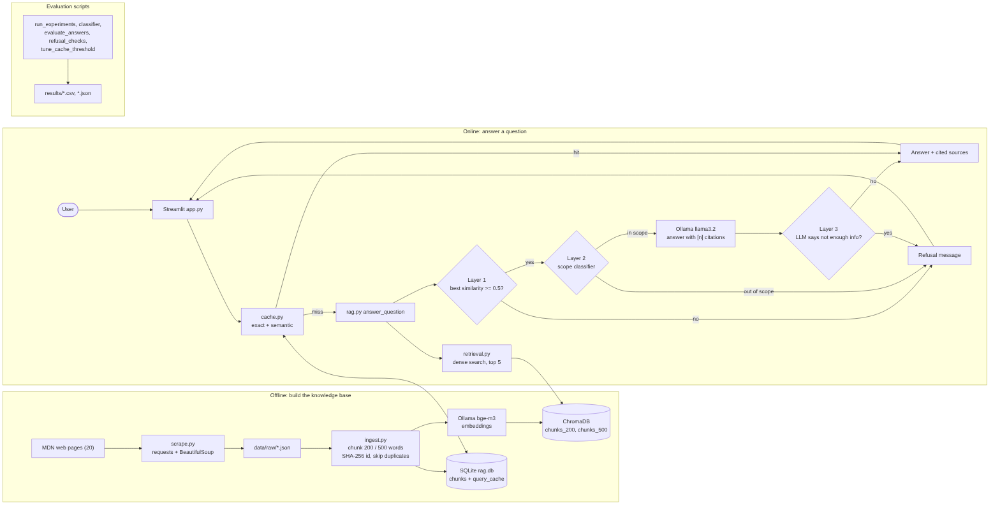

# Knowledge Q&A (RAG) MVP

A local question-answering system over 20 pages of MDN Web Docs (HTML, CSS and JavaScript basics). It retrieves the most relevant passages, answers **only** from them with numbered citations, and **refuses** questions the knowledge base cannot support. It includes retrieval experiments, a trained in-scope / out-of-scope classifier, exact and semantic caching, an evaluation suite and unit tests. Everything runs locally with free tools.



## Features

- **Repeatable ingestion:** scrape, clean, chunk (200 and 500 words), embed and store. Chunk ID = SHA-256 of URL + text, so running ingestion again adds **0** duplicates.
- **Three retrievers compared:** BM25 (keywords), dense (`bge-m3` vectors in ChromaDB) and hybrid (rank fusion).
- **Answers with citations:** the language model must use only the retrieved sources and cite them as `[1]`, `[2]`.
- **Three refusal layers:** similarity threshold, trained scope classifier, and the language model's own "not enough information".
- **Caching:** exact and semantic, with guards that stop similar-looking but different questions from sharing an answer.
- **Evaluation:** Recall@k, MRR, nDCG; faithfulness, relevance, hallucination rate and citation correctness; LLM judge compared with human labels; error analysis.
- **Streamlit interface** showing answers, cited sources, retrieved chunks, scores and cache hits.

## Folder structure

```
rag-mvp/
  app.py                    Streamlit interface
  config.py                 all settings (models, paths, thresholds, seed)
  requirements.txt
  src/
    scrape.py chunking.py db.py embedding.py ingest.py llm.py
    retrieval.py metrics.py rag.py cache.py classifier.py
    make_eval_set.py make_classifier_data.py make_cache_pairs.py
    run_experiments.py calibrate_threshold.py classifier_checks.py
    refusal_checks.py evaluate_answers.py compare_judge.py tune_cache_threshold.py
  tests/                    pytest unit tests
  data/                     evaluation, classifier, hard-test and cache-pair datasets
  models/                   trained scope classifier
  results/                  experiment tables, metrics, error analysis
  docs/                     plan, technical documentation, diagrams, demo guide, report
```

## Requirements

- Python 3.10 or newer
- [Ollama](https://ollama.com) installed and running
- About 5 GB of free disk space for the two models

## Setup

```bash
# 1. Python packages
pip install -r requirements.txt

# 2. Local models (Ollama must be running)
ollama pull bge-m3
ollama pull llama3.2

# 3. Check that Ollama is up (should print "Ollama is running")
curl http://localhost:11434
```

## Configuration

All settings are in `config.py`; nothing is hard-coded elsewhere. The important ones:

| Setting | Meaning | Default |
|---|---|---|
| `EMBED_MODEL`, `LLM_MODEL` | Ollama models for embeddings and answers | `bge-m3`, `llama3.2` |
| `JUDGE_MODEL` | Optional separate model for the quality judge | `None` (same as answerer) |
| `CHUNK_SIZES`, `CHUNK_OVERLAP` | Chunk sizes in words and overlap | `[200, 500]`, `40` |
| `RAG_CHUNK_SIZE` | Chunk size used for answering | `200` |
| `REFUSE_THRESHOLD` | Minimum best similarity to answer | `0.5` |
| `CLASSIFIER_THRESHOLD` | Minimum in-scope probability to answer | `0.5` |
| `CACHE_THRESHOLD`, `CACHE_GUARD_MODE` | Semantic cache setting (chosen with data) | `0.95`, `topic` |
| `RANDOM_SEED` | Makes splits reproducible | `42` |

There are no passwords or API keys in this project.

## Data preparation

```bash
python -m src.scrape      # downloads 20 MDN pages into data/raw/ (needs internet)
python -m src.ingest      # chunk, deduplicate, embed, store in SQLite + ChromaDB
python -m src.ingest      # run again: it must report "0 new" for each chunk size
```

Evaluation questions: `python -m src.make_eval_set` lets the language model **draft** questions (only drafts whose evidence text really exists in the page are kept). **Review every row by hand**, delete bad ones and save 30 to 50 good rows as `data/eval_dataset.csv`. The same draft-then-review process is used for the classifier data and the cache pairs.

## Model training and inference

**Classifier data and training**

```bash
python -m src.make_classifier_data     # drafts ~100 in-scope and ~100 out-of-scope questions
# review data/classifier_candidates.csv, save the cleaned file as data/classifier_data.csv
python -m src.classifier               # trains, evaluates, saves models/scope_classifier.joblib
python -m src.classifier_checks        # cross-validation + hand-written hard set (data/hard_test.csv)
```

**Inference** happens inside the app and `src/rag.py` through `ScopeClassifier.is_in_scope(question)`.

## Evaluation

```bash
python -m src.run_experiments          # retrieval table: 2 chunk sizes x 3 retrievers
python -m src.calibrate_threshold      # similarity scores of in-scope vs out-of-scope questions
python -m src.refusal_checks           # which refusal layer stops each hard question

python -m src.evaluate_answers         # answer quality (about 15-25 minutes)
# label results/human_label_sheet.csv (human_faithful, human_relevant = 1 or 0)
python -m src.compare_judge            # judge versus human labels
# review results/worst5.md and write the reasons and improvements

python -m src.make_cache_pairs         # drafts question pairs for the cache test
# review data/cache_pairs_candidates.csv, save the cleaned file as data/cache_pairs.csv
python -m src.tune_cache_threshold     # chooses guard mode and threshold; update config.py
```

`python -m src.evaluate_answers 5` runs only the first 5 questions for a quick test.

## Run the application

```bash
streamlit run app.py
```

Try: an in-scope question, an unrelated question, a near-topic question, the same question twice, then a paraphrase of it.

## Run the tests

```bash
python -m pytest tests
```

The tests use fake models and in-memory databases, so they need neither Ollama nor internet.

## Results

All numbers come from scripts and are stored in `results/`:

| File | Content |
|---|---|
| `experiments.csv` | Retrieval experiments (Recall@5, MRR, nDCG@5) |
| `classifier_results.json`, `classifier_checks.json` | Classifier test set, baseline, cross-validation, hard set |
| `refusal_checks.csv`, `refusal_checks.json` | Which safety layer stopped each hard question |
| `answer_eval.csv`, `answer_metrics.json` | Per-question and overall answer quality |
| `judge_agreement.json`, `judge_disagreements.csv` | LLM judge compared with human labels |
| `cache_threshold.csv` | Cache guard modes and thresholds |
| `worst5.md` | Error analysis of the five worst answers |

The summary and interpretation are in `docs/experiment_report.pdf` (one page).

## Models, versions, licences and data sources

Fill the version column with the commands shown below the table.

| Component | Version | Licence | Use |
|---|---|---|---|
| Ollama | TODO | MIT | Runs the local models |
| `bge-m3` (BAAI) | TODO (`ollama list`) | MIT | Embeddings |
| `llama3.2` 3B (Meta) | TODO (`ollama list`) | Llama 3.2 Community Licence | Answers, drafting, judge |
| ChromaDB | 1.5.9 | Apache 2.0 | Vector database |
| rank_bm25 | 0.2.2 | Apache 2.0 | Keyword retrieval |
| scikit-learn, NumPy | TODO | BSD | Classifier, metrics, vectors |
| Streamlit | TODO | Apache 2.0 | Interface |
| requests, BeautifulSoup4 | TODO | Apache 2.0, MIT | Scraping |
| pytest | TODO | MIT | Tests |
| Python / SQLite | TODO (`python --version`) | PSF / public domain | Language, database |

```bash
python --version
pip freeze | findstr /i "streamlit scikit-learn numpy chromadb rank_bm25 requests beautifulsoup4 pytest"
ollama --version
ollama list
```

**Data source:** 20 public pages of the [MDN Web Docs](https://developer.mozilla.org/) by Mozilla and contributors (the HTML elements `a`, `div`, `img`, `form`, `table`, `ul`, `input`, `button`; the CSS properties `color`, `display`, `margin`, `padding`, `position`, `font-size`, `flex`; the JavaScript `let`, `const`, `function`, `Array.map`, `Array.filter`). MDN text is published under a Creative Commons Attribution-ShareAlike licence (see MDN's own copyright page for the exact terms). The raw pages are not committed; they are downloaded by `src.scrape` with a polite delay, and every answer links back to its source page.

## AI tools used (disclosure)

- **Claude (Anthropic)** was used as a coding, design and writing assistant: it helped plan the architecture and drafted the first versions of the source code, unit tests, diagrams and these documents. I ran the code, reviewed it, and can explain it.
- **`llama3.2` through Ollama** is part of the system (answers and judge) and was also used to **draft** the evaluation questions, classifier questions and cache pairs. All of these were reviewed by me; wrong rows were deleted.
- The 20-question hand-checked hard set for the classifier was drafted with Claude and verified by me against the scraped pages.
- The human faithfulness and relevance labels used to check the LLM judge are my own.

## Known limitations

Small knowledge base and evaluation sets; LLM-written questions favour keyword search; a 3B model is a weak judge; the classifier cannot know exactly which topics are covered; cache guards miss some paraphrases; a few scraped characters are garbled. Details and future work are in `docs/technical_documentation.md`.

## Documentation index

- `docs/requirements_and_plan.md` requirements, priorities, plan, risks
- `docs/technical_documentation.md` technology selection, HLD, LLD, schema, methodology
- `docs/diagrams/` architecture, ingestion flow, query flow, schema (`.mmd` source and `.png`)
- `docs/demo_and_presentation.md` demo script, presentation outline, likely questions
