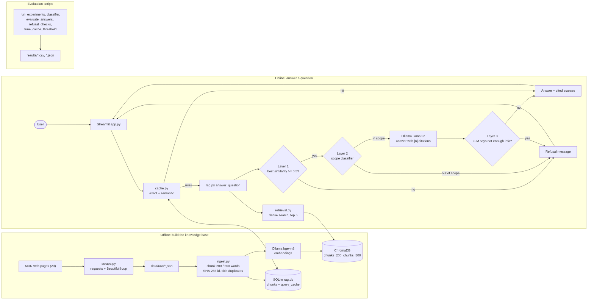
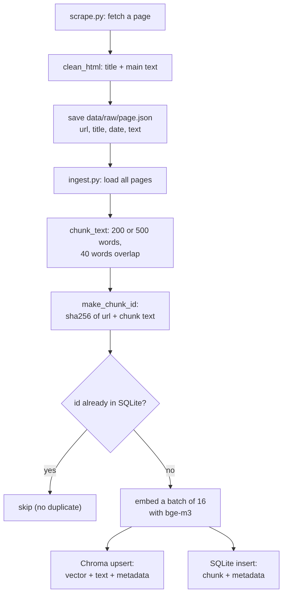
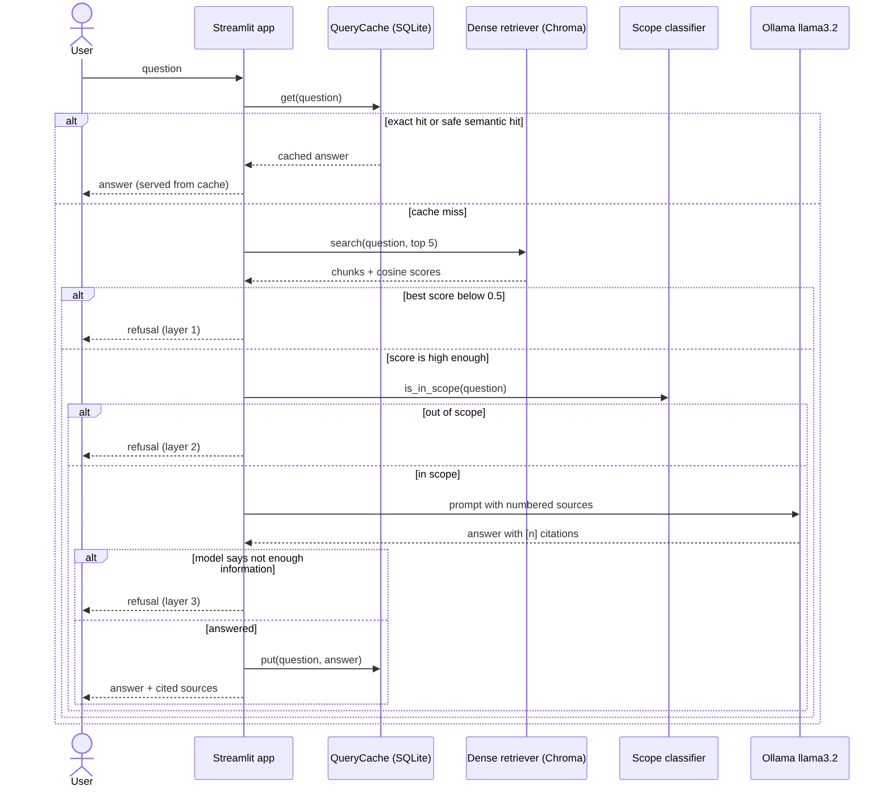
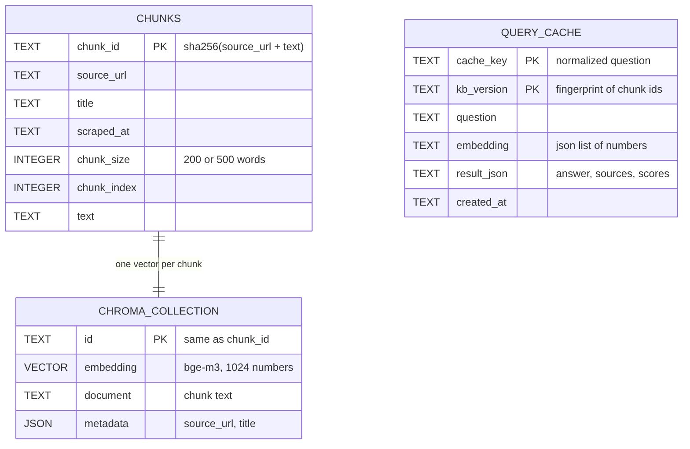

# Technical Documentation

This document explains **what was built, why, and how it works**: technology selection, high-level design (HLD), low-level design (LLD), database schema, data flow, evaluation methodology, testing and limitations. Numeric results are in `results/` and in the one-page experiment report; they are not repeated here so that there is a single source of truth.

---

## 1. Technology selection

For each component: why it was selected, what it does, advantages, limitations and alternatives considered.

### 1.1 Python, NumPy, scikit-learn
- **Why:** the language of the assignment; the ecosystem for data science is the strongest.
- **Functionality:** all pipeline code; NumPy for vectors and similarity; scikit-learn for Logistic Regression, train/validation/test splitting, cross-validation and metrics.
- **Advantages:** simple, readable, well-tested implementations I can explain.
- **Limitations:** scikit-learn models are not GPU-based; fine for 200 questions.
- **Alternatives:** PyTorch or Hugging Face Transformers for fine-tuning a cross-encoder (more powerful, slower and harder to explain within 20 hours).

### 1.2 `requests` and BeautifulSoup (scraping)
- **Why:** the most basic and widely understood way to download and parse web pages.
- **Functionality:** download a page, keep the `<main>` article, drop scripts, navigation and footers, normalise whitespace, save a JSON snapshot.
- **Advantages:** few lines, easy to debug, polite delay between requests.
- **Limitations:** no JavaScript rendering; website layout changes can break extraction; a character-encoding issue leaves a few garbled characters in some pages.
- **Alternatives:** Scrapy (more than needed), Playwright or Selenium (needed only for JavaScript-heavy sites).

### 1.3 SQLite
- **Why:** built into Python, zero setup, a single file, enough for one user.
- **Functionality:** stores chunk text and metadata (the source of truth for chunks) and the query cache.
- **Advantages:** transactional, queryable with SQL, nothing to install.
- **Limitations:** not for many concurrent writers; no built-in vector search.
- **Alternatives:** PostgreSQL (better for multi-user services, more setup).

### 1.4 ChromaDB (vector database)
- **Why:** persistent, local, simple Python API, supports cosine similarity and metadata.
- **Functionality:** one collection per chunk size (`chunks_200`, `chunks_500`) storing embedding, text and metadata; `upsert` makes re-runs safe.
- **Advantages:** minimal setup, persistent on disk, approximate nearest-neighbour index.
- **Limitations:** a young library whose versions change quickly; I record the version used.
- **Alternatives:** FAISS (fast, but needs separate storage for text and metadata), pgvector (needs PostgreSQL).

### 1.5 `bge-m3` embeddings through Ollama
- **Why:** a strong open multilingual embedding model that runs locally; I already knew the Ollama interface.
- **Functionality:** turns a chunk or a question into a vector of 1024 numbers; similar meaning gives similar vectors. The same model embeds chunks, queries, classifier inputs and cache keys, so everything lives in one vector space.
- **Advantages:** good quality, free, offline.
- **Limitations:** relatively large and slow on a CPU; must be served by Ollama.
- **Alternatives:** `all-MiniLM-L6-v2` from sentence-transformers (smaller and faster, lower quality).

### 1.6 `rank_bm25` (keyword retrieval)
- **Why:** BM25 is the standard keyword baseline; it is strong when questions reuse the document's words.
- **Functionality:** ranks chunks by weighted word overlap with the question (rare words count more; very long chunks are penalised).
- **Advantages:** no model, instant, explainable.
- **Limitations:** misses paraphrases and synonyms.
- **Alternatives:** Elasticsearch or OpenSearch (production-grade, heavy setup).

### 1.7 `llama3.2` (3B) through Ollama (answer generation and judge)
- **Why:** small enough for a laptop; follows simple instructions such as "use only the sources and cite them".
- **Functionality:** writes the answer from numbered source passages; also drafts evaluation questions and acts as the quality judge.
- **Advantages:** free, private, no API key.
- **Limitations:** a 3B model sometimes ignores instructions, makes weak judgements and prefers its own answers when judging; context window is limited, so only five 200-word chunks are sent.
- **Alternatives:** larger local models (for example 8B) or hosted APIs: better quality, more hardware or cost. `JUDGE_MODEL` in `config.py` allows a separate judge model.

### 1.8 Logistic Regression (scope classifier)
- **Why:** a simple, fast, well-understood model that works well on dense embeddings and is easy to explain.
- **Functionality:** predicts the probability that a question is **in scope** (answerable by the knowledge base).
- **Advantages:** trains in seconds, little overfitting risk with a regularisation setting (`C`), probabilities are interpretable.
- **Limitations:** sees only the question text, so it cannot know exactly which topics the 20 pages cover.
- **Alternatives:** fine-tuning a cross-encoder or small transformer (more accurate, more data and time), SVM or random forest (no clear advantage here).

### 1.9 Streamlit
- **Why:** a working chat interface in under 100 lines.
- **Functionality:** question box, answer, cited sources, retrieved chunks with scores, cache and classifier information, "Clear cache" button.
- **Advantages:** very fast to build and demo.
- **Limitations:** single-user demo, not an API.
- **Alternatives:** FastAPI with a separate front end (better for integration and multi-user use).

### 1.10 pytest
- **Why:** the standard Python testing tool with simple `assert` tests.
- **Functionality:** unit tests for chunking, hashing, deduplication, retrieval, metrics, refusal logic, classifier, cache, evaluation and the refusal funnel. Fakes replace Ollama, so tests run in seconds without it.
- **Limitations:** tests with fake models prove the logic, not the real model quality; real quality is measured by the evaluation scripts.

---

## 2. High-level design (HLD)

The system has three parts.

**Offline: build the knowledge base.** `scrape.py` downloads 20 MDN pages into JSON snapshots. `ingest.py` cuts them into chunks (200 and 500 words, 40 words overlap), gives each chunk a SHA-256 ID, skips chunks that already exist, embeds the new ones with `bge-m3`, and stores vectors in Chroma and text with metadata in SQLite.

**Online: answer a question.** The Streamlit app first asks the cache. On a miss, `rag.py` retrieves the top 5 chunks by dense search and applies **three safety layers** before returning an answer:

1. **Similarity threshold:** if the best chunk has cosine similarity below 0.5, refuse (the language model is never called).
2. **Scope classifier:** if the trained model says the question is out of scope, refuse.
3. **Language model refusal:** the prompt tells the model to reply "I don't have enough information…" when the sources do not contain the answer; that reply is detected and shown as a refusal.

Only real answers are cached.

**Evaluation scripts.** Separate scripts produce all reported numbers and write files to `results/`.

### Key design decisions

| Decision | Reason |
|---|---|
| Chunk ID = SHA-256 of URL + text | The same content always gets the same ID, so re-runs cannot create duplicates. |
| SQLite and Chroma both store chunks | SQLite is the source of truth and serves BM25 and metadata; Chroma serves vector search. |
| 200-word chunks with dense retrieval for answering | Recall was close to the best setting; five 200-word chunks fit the model's context; dense gives a cosine score usable for refusal and caching. |
| Three refusal layers | Each layer catches different mistakes; no single threshold separates near-topic questions. |
| Cache stores answers only, with a knowledge-base fingerprint | Refusals are never repeated by mistake, and old answers are ignored if the data changes. |
| Everything configurable in `config.py` | One place to change models, thresholds and paths. |

---

## 3. Data flow

### 3.1 Ingestion

### 3.2 Answering a question

---

## 4. Database schema

- **`chunks` (SQLite):** one row per chunk. `chunk_id` is the primary key, so `INSERT OR IGNORE` ignores duplicates. `chunk_size` separates the 200-word and 500-word versions.
- **Chroma collections `chunks_200` and `chunks_500`:** use cosine space. Each entry has the same `id` as `chunk_id`, the embedding, the chunk text and the metadata `source_url` and `title`. Similarity is computed as `1 − distance`.
- **`query_cache` (SQLite):** the primary key is (`cache_key`, `kb_version`). `cache_key` is the normalised question; `kb_version` is a 12-character fingerprint of all chunk IDs. If the knowledge base changes, old rows no longer match. `embedding` is stored as JSON for semantic lookup; `result_json` holds the full answer, sources and scores.

---

## 5. Low-level design (LLD)

| File | Purpose | Key functions |
|---|---|---|
| `config.py` | All settings: models, paths, chunk sizes, thresholds, seed | constants only |
| `src/scrape.py` | Download and clean pages, save JSON | `fetch_page`, `clean_html`, `scrape_all` |
| `src/chunking.py` | Word-based chunks with overlap; chunk ID | `chunk_text`, `make_chunk_id` |
| `src/db.py` | SQLite connection and `chunks` table | `create_tables`, `chunk_exists`, `save_chunk`, `count_chunks` |
| `src/embedding.py` | Calls Ollama `/api/embed` with `bge-m3` | `create_embedding` |
| `src/ingest.py` | Chunk, deduplicate, embed, store | `build_chunks`, `ingest`, `main` |
| `src/llm.py` | Calls Ollama `/api/generate` (optional JSON mode, optional model) | `generate` |
| `src/retrieval.py` | Three retrievers with the same `search(query, k)` interface | `BM25Retriever`, `DenseRetriever`, `HybridRetriever` |
| `src/metrics.py` | Retrieval metrics written by hand | `is_relevant`, `recall_at_k`, `reciprocal_rank`, `ndcg_at_k` |
| `src/rag.py` | Prompt building, refusal layers, citation parsing | `answer_question`, `build_context`, `find_cited_numbers` |
| `src/classifier.py` | Train and use the scope classifier | `run_training`, `evaluate`, `ScopeClassifier` |
| `src/cache.py` | Exact and semantic query cache with safety guards | `QueryCache`, `is_safe_match`, `answer_with_cache`, `guard_setup` |
| `src/make_eval_set.py`, `make_classifier_data.py`, `make_cache_pairs.py` | The LLM drafts datasets; a human reviews them | — |
| `src/run_experiments.py` | Retrieval experiment table | `evaluate`, `main` |
| `src/calibrate_threshold.py` | Shows similarity scores of in-scope and out-of-scope questions | `main` |
| `src/classifier_checks.py` | Cross-validation and hand-written hard test | `cross_validate`, `test_on_hard_set` |
| `src/refusal_checks.py` | End-to-end test of the three refusal layers | `run_checks`, `summarize` |
| `src/evaluate_answers.py` | Faithfulness, relevance, hallucination, citations, worst five | `evaluate_one`, `compute_metrics`, `worst_answers` |
| `src/compare_judge.py` | Judge versus human labels | `agreement_rate`, `kappa`, `summarize` |
| `src/tune_cache_threshold.py` | Chooses guard mode and similarity threshold | `evaluate_threshold`, `choose_setting` |
| `app.py` | Streamlit interface | — |

### 5.1 Algorithms

**Chunking.** Words are split on whitespace; a chunk takes `chunk_size` words and the next one starts `chunk_size − overlap` words later. The overlap prevents a sentence at a border from being lost.

**BM25.** Text is lower-cased and tokenised with `\w+`. `BM25Okapi` scores all chunks of one size; the top *k* are returned. The index is built in memory from SQLite.

**Dense retrieval.** The question is embedded with `bge-m3` and Chroma returns the nearest chunks by cosine distance.

**Hybrid retrieval (Reciprocal Rank Fusion).** Take the top 20 of BM25 and of dense. Each chunk gets `1 / (60 + rank)` points from each list; chunks are sorted by total points. A chunk both methods like rises to the top.

**Answer generation.** The prompt contains the numbered sources `[1] (title) text`, the instruction to use only these, to cite after each fact and to reply with a fixed sentence if the sources do not answer. Citations `[n]` are parsed; numbers that do not exist are ignored; the displayed sources are only the cited chunks. If an answer has no citation, a warning is shown.

**Scope classifier.** Input: the `bge-m3` embedding of the question. Output: probability of "in scope". Training uses a stratified 70/15/15 split (seed 42). The regularisation strength `C` is chosen from {0.1, 1, 10} on the validation set only; the test set is used once. The old rule "best similarity at least 0.5" is evaluated on the same test questions as a baseline.

**Cache.** Normalise the question (lower-case, remove punctuation). *Exact* lookup uses the normalised text. *Semantic* lookup embeds the question and compares it with cached questions by cosine similarity. A semantic hit must reach the threshold **and** pass the guard mode chosen by `tune_cache_threshold.py`:

- *numbers:* the numbers in both questions are the same;
- *negation:* both or neither contain a negation;
- *topic words* (mode `topic`): the words that also appear in page titles (for example `margin`, `padding`, `map`, `filter`) are the same.

This prevents, for example, "what does margin do" from reusing the answer for "what does padding do", which the embedding model considers almost identical.

### 5.2 Evaluation methodology

**Retrieval (experiments).** The evaluation set holds questions, expected answers and an *evidence passage* (6 to 12 words copied exactly from the page). A retrieved chunk is **relevant** if it contains the evidence words, which works for any chunk size. Metrics:

- **Recall@k:** the fraction of questions where a relevant chunk is in the top *k*. With one evidence passage per question this equals hit-rate.
- **MRR:** the average of `1 / rank` of the first relevant chunk.
- **nDCG@k:** a hit at rank *r* scores `1 / log2(r + 1)`; only the first hit counts, so the ideal score is 1.

Two chunk sizes (200, 500 words) and three retrievers (BM25, dense, hybrid) give six configurations.

**Answer quality** (`evaluate_answers.py`). Each metric states its denominator:

| Metric | Definition |
|---|---|
| False refusal rate | in-scope questions refused / all questions |
| Faithfulness | answers whose every fact the judge finds in the sources / answers graded |
| Answer relevance | answers that address the question / answers graded |
| Hallucination rate | sentences the judge finds unsupported / sentences checked |
| Citation correctness | answers whose cited chunks contain the gold evidence / answered questions |
| Citation present | answers with at least one `[n]` / answered questions |

Faithfulness, relevance and hallucination come from an LLM judge. To measure how far the judge can be trusted, I label a sample of answers by hand (the judge's opinion is hidden while labelling) and `compare_judge.py` reports agreement, Cohen's kappa, and how often each says "yes".

**Classifier.** Test-set precision, recall, F1 and confusion matrix; five-fold cross-validation over all labelled questions; a hand-checked hard set of near-topic and differently worded questions; and the old similarity rule as baseline.

**Refusal funnel.** `refusal_checks.py` runs the hard set through the whole pipeline and records which layer stopped each question, or that it was answered.

**Cache.** Labelled pairs of questions (same meaning or different) are scored with similarity thresholds 0.80 to 0.97 and four guard modes; the chosen setting has zero wrong reuses with the most correct reuses.

**Error analysis.** The five worst answers are ranked by a simple points system and written to `results/worst5.md` with the retrieved context and an automatic hint (retrieval miss versus generation problem); the reasons and improvements are written by hand.

---

## 6. Testing strategy

- **Unit tests (pytest):** chunk size and overlap, ID hashing, duplicate prevention, metric values on small known examples, BM25 and dense retrieval with fake embeddings, hybrid fusion, refusal layers with fake retrievers and models, citation parsing, classifier splitting and training on synthetic data, cache exact/semantic/guard behaviour, cache invalidation, threshold selection, evaluation aggregation, the refusal funnel.
- **Fakes instead of Ollama:** a fake embedder (chosen vectors), a fake language model (fixed replies) and in-memory SQLite and Chroma make the tests fast and deterministic.
- **Integration and quality testing:** the evaluation scripts run the real models on real data and write their results to files.
- **Manual testing:** the Streamlit app, using in-scope, out-of-scope and near-topic questions, repeated and paraphrased questions.
- **Run all tests:** `python -m pytest tests`.

---

## 7. Reproducibility

- All settings are in `config.py`; random seed is 42.
- The pipeline is scripted end to end (commands in the README).
- Raw page snapshots are saved so later steps do not depend on the live website.
- Datasets drafted by the language model are reviewed by hand and the reviewed versions are kept in `data/`.
- Software versions and model names are listed in the README.

---

## 8. Known limitations

1. **Small knowledge base and small evaluation sets.** Differences of one or two questions are noise; results are indicative.
2. **LLM-written evaluation questions** reuse words from the source text, which favours keyword search (BM25). The 500-word chunk comparison is not perfectly like-for-like because five large chunks cover more text than five small ones.
3. **A 3B model as answerer and judge** can be inconsistent and kind to its own output; human labels are used to measure this.
4. **The scope classifier sees only the question.** It learns "sounds like web development", not "covered by these 20 pages", so near-topic questions can pass it; the other two layers compensate partly.
5. **Cache guards are conservative.** Valid paraphrases are missed when they use ordinary words that are also page titles (for example "function") or different plural forms.
6. **Scraping encoding:** a few characters in some pages are garbled (for example dashes); this adds small noise to chunks.
7. **Single user, local only,** no authentication.

## 9. Future work (with another week)

- A cross-encoder reranker over the top 20 chunks.
- More out-of-scope training questions about topics next to the knowledge base, and a retrieval-aware classifier that also uses the retrieval score.
- A larger human-labelled evaluation set and a stronger judge model.
- Fix the encoding issue in scraping and re-ingest.
- Better cache guards (plural handling, ignoring ordinary title words) and a larger labelled pair set.
- Expose the pipeline as an API (FastAPI) and package it with Docker.
- Scheduled re-scraping with change detection.
